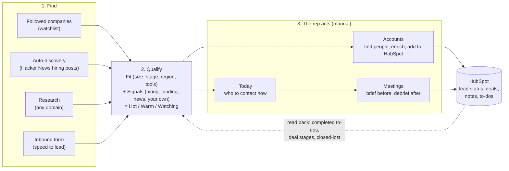

# F1rstword

[](https://github.com/rudrat04/gtm-copilot/actions/workflows/ci.yml)

**Know who to talk to, and when.** F1rstword finds the right companies and the right people, watches the signals that matter, and keeps HubSpot in step, so a sales rep can spend their day on conversations instead of research. **Outreach stays manual: nothing is ever sent to a prospect.**

Live demo: https://copilot.f1rstword.com  ·  2-minute walkthrough: [DEMO.md](DEMO.md)  ·  One-page case study: [CASE_STUDY.md](CASE_STUDY.md)

## Why I built it

I built this for GTM engineering, because I got hooked on revenue operations and automation: the idea that one well-built system can quietly do the work that eats a sales team's day.

Outbound at volume doesn't make sense. Thousands of emails go to the wrong people, at the wrong time, with no real signal behind them. What closes deals is a rep writing to the right person at the moment something changed. Meanwhile good leads get missed: a company raises money, opens sales roles or hires a new head of sales and nobody notices, or a demo request waits a few hours and goes cold.

Sales teams don't need more leads. They need **the right lead, at the right time, with a real reason to reach out.** That is what this does.

## The idea in one picture



## What a rep sees

| Tab | The question it answers | What it does |
|---|---|---|
| **To-do** | Who do I contact right now? | A priority board of **people** in lanes (Contact now, This week, Waiting for a reply, Worth a look), each a full person card with the company's fit and what is happening. Pin or set aside; sort by priority, fit or newest. A bell collects alerts. Before: a short list led by the **person** (name, title, buyer type), with a one-line "why today", the fresh signals and a next step. Followed companies come first. Follow-ups at day 3, 7 and 14. A "Needs attention" card flags what is slipping. |
| **People** | Who do I talk to? | The main tab. People at the companies that fit, listed free (names shortened until you reveal one for 1 credit), each with the company's fit and heat, buyer type, decision-maker flag, what is happening in their own team and what they are doing (events, talks, posts). A Companies view sits beside it. |
| **Companies** (inside People) | Where is every company? | One list with clear views (Prospects, In progress, Parked, Low fit, Watching, All, Removed), filters, sorting and search. Every card shows labelled facts (size, stage, location, industry, tools, sales style, with "Unknown" when we don't know), why it fits, why now, the best contact and one next step. Follow, find more people, remove (with undo). |
| **Conversations: Inbound** | Who just raised their hand? | A form submit is enriched, scored and routed in about 10 seconds: an email to the rep, a HubSpot to-do due in 15 minutes, and a reminder if nobody answers. Shows time to reply. |
| **Conversations: Meetings** | What is booked, and how did it go? | A private brief is emailed when a meeting is booked. After it ends, a one-tap "how did it go?" email updates HubSpot and turns two lines of notes into a recap and a follow-up draft. Cancellations and moves are handled. |
| **Search (Ctrl or Cmd + K)** | Tell me about this company. | Jump to any company, person, page or action, or research any domain for a dossier in about 10 seconds. Every company has its own page (card, signals, movements, history). |
| **Setup** | What are we looking for? | Describe what you sell and get suggestions for everything else. Searchable industry, stage and location lists, buyer types in priority order (job titles, department, seniority), signals you add yourself, alerts and the daily email, name and logo, and a Health panel. |

## Set it up in one sentence

In **Setup**, describe what you sell (and optionally your website). One small AI call proposes your ideal industries, company size, funding stages, regions, buyer types with job titles, hiring roles, tools that are a good or bad sign, competitors and exclusions. You review and edit, then save. Fit is calculated for you from those choices; there are no weights to tune. The HubSpot "Scored persona" value is matched or created automatically.

**Signals you can add:** uses a tool, uses a competitor, press and announcements, company changes (leadership, expansion, acquisition) and your own watch phrases, on top of hiring, funding and community buzz.

## How it works

- **Signals** (free public sources): job boards (Greenhouse, Lever, Ashby), news, Hacker News, and PredictLeads company events within a monthly cap. A small AI check drops namesake noise ("Linear", "Orb").
- **Fit** comes from real company data (headcount, funding stage, region, industry, tools) against your profile. **Hot** means it fits and something happened this week, it just raised, or it has 2+ sales roles open. A 0-100 score still exists behind the scenes for sorting and for the HubSpot fields.
- **Watchlist:** follow any company by star or website. A followed company is never hidden by the fit bar, is checked first every day and has its own alert allowance.
- **Auto-discovery** reads the latest Hacker News "Who is hiring" and "Launch HN" posts, searches Hunter's company database (free, with the same industry, size and location filters as Setup), lists Y Combinator companies that are hiring, and searches the public web (Claude's web search: recent funding, new sales leaders, sales hiring, launches) each week, keeps companies hiring sales or RevOps roles, asks one cheap AI question ("is this a B2B software company?"), checks size and stage, and adds the ones that fit. For the best fits it also finds the right people and has the AI judge timing, so they appear on Today ready to contact.
- **People:** a search by your buyer-type job titles, ranked against your buyer types, checked against HubSpot, so anyone who opted out or bounced is never suggested and people you already know are marked. Enriching an email and pushing to HubSpot are separate, deliberate steps. A bulk "find people for the top companies" shows the credit cost first.
- **HubSpot, both ways:** writes lead status, a deal (only ones it created), notes, to-dos and about 30 columns; reads back completed to-dos, deal changes and closed-lost deals, which come back as Revival when something new happens at the company.
- **Pipeline watch:** flags what is off (a hot account untouched, an overdue follow-up, a lead past its reply target, a stuck deal) and clears each flag itself when the cause is fixed.
- **Rules, not a black box:** scores, labels and lead routing are fixed rules. AI writes only a few short things (a dossier, a one-line "why now", a recap, an email draft someone edits, the Setup suggestion).
- **White-label:** change the name, tagline and logo in Setup.

## A day in the life

| When (IST, UTC in brackets) | Job | Result |
|---|---|---|
| every minute | `meeting-brief` | Briefs for new meetings, "how did it go?" emails, cancel/move alerts, lead reminders |
| every 30 min | `crm-sync` | Reads HubSpot back |
| every 3 hours | `flags-urgent` | Urgent problems only |
| 06:30 (01:00) | `signal-watch` | Re-reads sources for queued and followed companies, stores new signals, instant hot alerts (you set how many) |
| 08:00 (02:30) | `daily-digest` | Today list emailed, HubSpot to-dos created. The time is set in Setup. |
| Mondays 10:30 (05:00) | `discover` | Finds new companies |
| Mondays 11:30-12:25 (06:00-06:55) | `signal-scan` | Full weekly scan and scoring |
| 08:47 (03:17) | `cp-logs-cleanup` | Deletes logs older than 30 days |

Everything emails the owner only.

## Stack and cost

Supabase (Postgres, Edge Functions on Deno, pg_cron), HubSpot Free, Hunter free plan, PredictLeads (capped), Google Calendar and Gmail (owner only), Claude Haiku 4.5, and one static page on GitHub Pages.

| Thing | Cost |
|---|---|
| Setup suggestion | about 1 to 2 cents |
| Account dossier | about $0.0055 |
| Relevance check, per company scan | about $0.0004 |
| Auto-discovery, per candidate | about $0.0008 (+ 0.2 Hunter credit if it passes) |
| Inbound lead, AI part | about $0.0008 (+ 0.2 Hunter credit if the company is new) |
| Meeting recap | about $0.0017 |
| "Why today" line | about $0.0004 |

The whole project, including every build and test run, has used well under $1 of AI. A $0.25 daily AI cap, a monthly Hunter cap and a monthly PredictLeads cap are enforced in the database.

## Security

- **Two doors, two keys.** Public visitors can read and try the demo; saving anything or seeing full names and emails needs the owner key. Scheduled jobs reject everyone except the scheduler, whose secret lives only in the database.
- **Public endpoints can't burn credits:** research and the inbound form are rate limited (per person, per hour and per day), with a daily AI cap and monthly provider caps on top. A daily cap also protects HubSpot from fake form submissions.
- **Secrets stay out of logs and URLs.** Every log line is scrubbed; raw IP addresses are never stored.
- **Database:** every table has row level security with no public policies. The one-tap debrief links are signed (HMAC) and bound to one meeting and one outcome.
- **Page:** a content security policy limits it to this project's backend; all dynamic text is escaped; logos are small validated images. Public views show names as "First L." with masked emails and no private notes.

## Run it yourself

1. Create a Supabase project, apply `supabase/migrations/` in order, load `supabase/seed.sql`.
2. Copy `.env.example` to `.env` and fill it in (HubSpot service key, Anthropic key, Hunter key, owner key, Google OAuth client, optionally PredictLeads).
3. `node scripts/google-auth.mjs` signs in to Google once.
4. `npx supabase secrets set --env-file .env`, then deploy each function with `npx supabase functions deploy <name> --use-api --project-ref <ref>`.
5. `node scripts/hubspot-columns.mjs` creates the custom HubSpot columns (safe to re-run).
6. Serve `docs/` on any static host, unlock owner mode, and describe what you sell in Setup.

To use it for a client's own form, post JSON (`name`, `email`, `company`, `role`, `intent`, `message`, `source`) to the `inbound` function.

## Checks and debugging

```bash
cd supabase/functions && deno lint && deno test --no-lock --allow-env --allow-read tests/   # unit tests for scoring, fit, labels, buyer types, signals, validation and log redaction
node scripts/check-page.mjs && bash scripts/secret-scan.sh                               # the page parses and keeps its security policy; no secrets committed
bash scripts/smoke.sh        # 40 security and behaviour checks against the live project, no credits used
```

Lint, type checks, unit tests, the page check and the secret scan run on every push in GitHub Actions. The lead webhook and the permission model are documented in [API.md](API.md).

Every function run writes structured rows to `cp_logs` with a `run_id` that failed requests return:

```sql
select * from cp_recent_problems limit 50;          -- what went wrong recently
select * from cp_log_summary;                       -- 24-hour health
select feature, count(*), round(sum(cost_usd)::numeric, 4) usd from cp_ai_usage group by feature;
```

`CLAUDE.md` is the engineering briefing (structure, rules, how each part works).

## Principles

Outreach is human. The system says who to contact, why now, and what to say, and keeps the CRM honest. Every number is explainable. Public visitors never see full names or emails.
